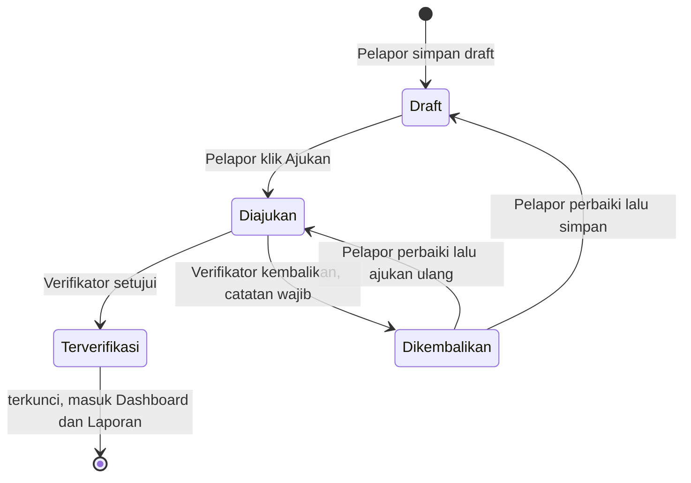
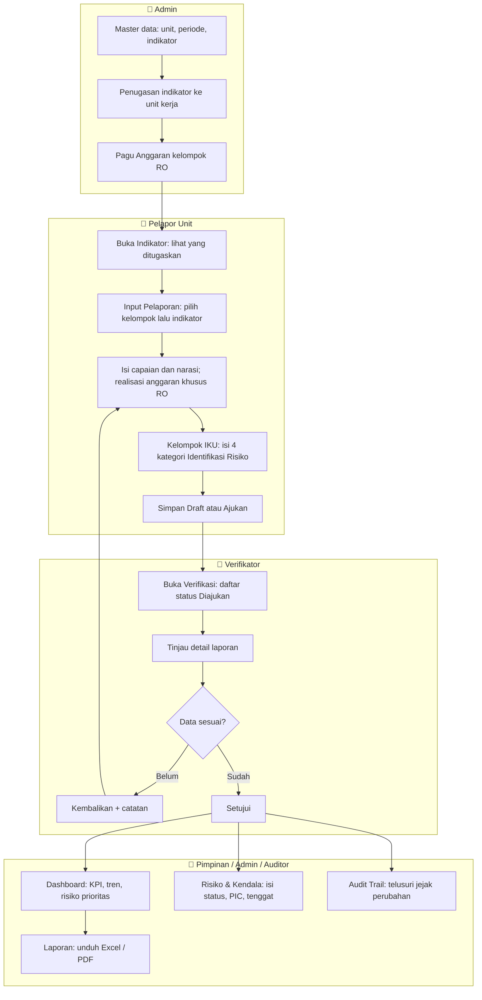
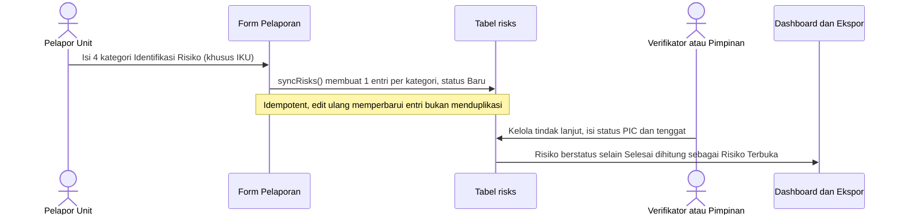

# SITU-KSG — Panduan Pengujian Aplikasi

Sistem Informasi Terpadu Direktorat Konservasi Spesies dan Genetik: aplikasi pemantauan capaian indikator kinerja (IKU/IKP/IKK/RO), pelaporan realisasi, verifikasi berjenjang, pengelolaan risiko, dan pelaporan/ekspor.

Dokumen ini adalah **panduan pengujian** — cara menyiapkan data uji, akun mana yang dipakai untuk alur mana, dan urutan langkah end-to-end sampai laporan bisa diunduh. Untuk spesifikasi bisnis lengkap lihat [`docs/specs/SITU-KSG-Development-Spec.md`](docs/specs/SITU-KSG-Development-Spec.md); untuk rencana kerja bertahap lihat [`docs/specs/dev-plan/00-overview.md`](docs/specs/dev-plan/00-overview.md).

**Stack:** Laravel 13 · Livewire 4 (single-file components) · MaryUI + daisyUI + Tailwind v4 · MySQL · Pest 5

---

## 1. Persiapan lingkungan

```bash
composer setup     # install deps, .env, key:generate, migrate, npm install, npm run build
composer run dev   # jalankan dev server + vite + queue worker
```

Aplikasi juga otomatis tersedia lewat Laravel Herd di `http://situ-ksg.test`.

Setelah `composer setup`, database baru berisi **data baku minimal** saja:

```bash
php artisan db:seed    # 5 peran, 3 unit kerja, 24 indikator, 1 periode tahunan, 1 akun admin
```

| | |
|---|---|
| Akun admin baku | `admin@situksg.test` / `password` |

Data baku ini **belum cukup** untuk menguji Dashboard, Verifikasi, Laporan, atau Risiko — semuanya masih kosong. Untuk itu pasang data sampel di bagian berikut.

Urutan lengkap pada clone baru:

```bash
composer setup                                        # deps + migrate (data sampel dilewati, lihat catatan §2)
php artisan db:seed                                   # data referensi: peran, unit, indikator, admin
php artisan migrate:rollback --path=database/migrations/2026_08_01_174659_seed_sample_data_2026.php && php artisan migrate   # pasang data sampel
```

---

## 2. Memasang data sampel untuk pengujian

Data sampel 2026 dibuat sebagai **migration data**, bukan seeder biasa — sengaja terpisah dari `DatabaseSeeder` supaya tidak pernah ikut terbawa saat `php artisan db:seed` atau `migrate --seed` pada instalasi baku.

```bash
# PASANG data sampel
php artisan migrate

# LEPAS data sampel (kembali ke data baku)
php artisan migrate:rollback --path=database/migrations/2026_08_01_174659_seed_sample_data_2026.php
```

> **Pada clone baru**, `composer setup` menjalankan `migrate` **sebelum** `db:seed`, sehingga data referensi (peran, unit, indikator, periode aktif) belum ada. Migration data sampel akan **melewati dirinya sendiri dengan tenang** dalam kondisi itu — proses instalasi tidak gagal, tapi data sampel juga belum terpasang. Setelah `php artisan db:seed`, pasang menyusul dengan:
>
> ```bash
> php artisan migrate:rollback --path=database/migrations/2026_08_01_174659_seed_sample_data_2026.php && php artisan migrate
> ```
>
> Selalu targetkan lewat `--path` seperti di atas, **bukan** `--step=1` — sejak Fase 21 ada migration bertanggal lebih baru di belakang migration data sampel ini, `--step=1` akan me-rollback migration yang salah.

Berisi (Fase 21 — periode tahunan & triwulan): 1 periode tahunan historis tambahan ("Tahun Anggaran 2025", Q1–Q4 lengkap) di samping periode aktif yang sudah ada (Q1–Q3, tahun berjalan), 7 akun pengujian (satu per peran), 168 laporan kumulatif per triwulan mencakup seluruh 24 indikator dengan status & capaian bervariasi, 112 risiko, 144 catatan verifikasi, dan 48 pengaturan target/satuan/pagu per-indikator-per-periode (pagu hanya kelompok RO).

> **Penting:** `php artisan migrate:fresh --seed` akan **ikut memasang ulang** data sampel (karena migration dijalankan ulang dari nol). Untuk benar-benar kembali ke data baku minimal, jalankan `php artisan migrate:rollback --path=database/migrations/2026_08_01_174659_seed_sample_data_2026.php` setelahnya.

Detail lengkap (cakupan data, penanda unik, mekanisme rollback): [`docs/operations/sample-data-2026.md`](docs/operations/sample-data-2026.md).

---

## 3. Akun pengujian

Seluruh password: **`password`**. Domain `@contoh.situksg.test` sengaja berbeda dari admin baku agar keduanya bisa hidup berdampingan.

| Peran | Email | Unit Kerja | Dipakai menguji |
|---|---|---|---|
| **Admin** | `admin@contoh.situksg.test` | Direktorat KSG | Master data, pagu anggaran, audit trail, semua halaman |
| **Pelapor Unit** | `pelapor.dksg@contoh.situksg.test` | Direktorat KSG | Input & ajukan laporan, perbaiki laporan dikembalikan |
| **Pelapor Unit** | `pelapor.sks@contoh.situksg.test` | Subdit Konservasi Spesies | Isolasi data antar unit |
| **Pelapor Unit** | `pelapor.skg@contoh.situksg.test` | Subdit Konservasi Genetik | Isolasi data antar unit |
| **Verifikator** | `verifikator@contoh.situksg.test` | — | Setujui / kembalikan laporan, kelola tindak lanjut risiko |
| **Pimpinan** | `pimpinan@contoh.situksg.test` | — | Dashboard & laporan lintas unit, kelola tindak lanjut risiko |
| **Auditor** | `auditor@contoh.situksg.test` | — | Audit trail (baca-saja) |

> Verifikator, Pimpinan, dan Auditor sengaja **tanpa unit kerja** — mereka memang berperan lintas unit. Konsekuensinya halaman **Indikator** menampilkan peringatan "Akun Anda belum dikaitkan dengan unit kerja" untuk ketiga akun ini; itu perilaku yang benar, bukan bug.

---

## 4. Matriks akses halaman per peran

Ini jawaban untuk "halaman mana muncul untuk siapa". Menu yang tidak boleh diakses **tidak muncul di sidebar**, dan bila URL-nya dipaksa langsung akan menghasilkan **403**.

| Halaman | URL | Admin | Pelapor Unit | Verifikator | Pimpinan | Auditor |
|---|---|:--:|:--:|:--:|:--:|:--:|
| Dashboard | `/dashboard` | ✅ semua unit | ✅ unit sendiri | ✅ semua | ✅ semua | ✅ semua |
| Indikator | `/indikator` | ⚠️ | ✅ unit sendiri | ⚠️ | ⚠️ | ⚠️ |
| Realisasi (daftar) | `/realisasi` | ✅ semua | ✅ unit sendiri | ✅ semua | ✅ semua | ⚠️ |
| Input Pelaporan | `/realisasi/create` | ✅ | ✅ | ⛔ 403 | ⛔ 403 | ⛔ 403 |
| Verifikasi | `/verifikasi` | ✅ | ⛔ 403 | ✅ | ⛔ 403 | ⛔ 403 |
| Pagu Anggaran | `/pagu` | ✅ kelola | 👁️ baca | 👁️ baca | 👁️ baca | 👁️ baca |
| Risiko & Kendala | `/risiko` | ✅ kelola | 👁️ unit sendiri | ✅ kelola | ✅ kelola | 👁️ baca |
| Laporan & Ekspor | `/laporan` | ✅ semua | ✅ unit sendiri | ✅ | ✅ | ✅ |
| Audit Trail | `/audit-trail` | ✅ | ⛔ 403 | ⛔ 403 | ⛔ 403 | ✅ |
| Administrasi (5 halaman) | `/admin/*` | ✅ | ⛔ 403 | ⛔ 403 | ⛔ 403 | ⛔ 403 |

**Keterangan:**
- ✅ **kelola** — bisa membuat/mengubah/menghapus · 👁️ **baca** — halaman terbuka tapi tombol aksi tersembunyi/read-only
- ⚠️ pada **Indikator** — halaman terbuka, tapi hanya menampilkan data bila akun punya unit kerja
- ⚠️ pada **Realisasi** untuk Auditor — daftar difilter ke unit akun; karena Auditor tanpa unit, daftarnya kosong
- **Administrasi** = Pengguna, Unit Kerja, Periode, Indikator, Penugasan (dilindungi middleware `role:Admin`)

---

## 5. Alur status laporan



Aturan yang ditegakkan sistem:
- Laporan **Terverifikasi tidak bisa diedit lagi** oleh siapa pun lewat form.
- Pelapor Unit hanya bisa mengedit laporan **unitnya sendiri** dan hanya saat berstatus **Draft** atau **Dikembalikan**.
- Verifikator **wajib mengisi catatan** saat mengembalikan laporan.
- Hanya laporan **Terverifikasi** yang dihitung di KPI Dashboard dan masuk ekspor Ringkasan Kinerja.

---

## 6. Alur pengujian end-to-end sampai laporan



### Langkah pengujian berurutan

Pasang data sampel dulu (§2), lalu ikuti urutan berikut. Setiap langkah menyebut akun yang harus dipakai.

**Tahap 1 — Persiapan master data** · login `admin@contoh.situksg.test`
1. `/admin/units` — pastikan 3 unit kerja aktif.
2. `/admin/periods` — pastikan 12 periode bulanan 2026 + "Tahun Anggaran 2026" ada.
3. `/admin/indicators` — pastikan 24 indikator aktif (4 IKU, 4 IKP, 4 IKK, 12 RO).
4. `/admin/assignments` — pilih unit, pastikan indikator sudah tertugas.
5. `/pagu` — pastikan pagu hanya tersedia untuk indikator kelompok **RO**; coba tambah/edit pagu.

**Tahap 2 — Pelaporan** · login `pelapor.dksg@contoh.situksg.test`
6. `/indikator` — hanya indikator unit Direktorat KSG yang tampil.
7. `/realisasi` — hanya laporan unit sendiri yang tampil (bandingkan nanti dengan akun `pelapor.sks`).
8. `/realisasi/create` — pilih **kelompok** dulu, baru **indikator** (dua tahap); field lanjutan muncul setelah indikator dipilih.
9. Pilih indikator kelompok **RO** → muncul field "Realisasi Anggaran" dan "Pagu Anggaran RO" (read-only untuk Pelapor). Field anggaran tidak muncul untuk IKU/IKP/IKK.
10. Pilih indikator kelompok **IKU** → muncul blok **Identifikasi Risiko** (4 kategori, wajib diisi saat mengajukan). Coba klik "Ajukan" dengan salah satu kategori dikosongkan → harus muncul error validasi.
11. Isi lengkap → **Simpan sebagai Draft** → laporan muncul di `/realisasi` berstatus Draft.
12. Edit draft tadi → **Ajukan** → status berubah jadi Diajukan.

**Tahap 3 — Isolasi antar unit** · login `pelapor.sks@contoh.situksg.test`
13. `/realisasi` — laporan milik Direktorat KSG **tidak boleh** terlihat.
14. Paksa buka `/verifikasi` dan `/audit-trail` → harus **403**.

**Tahap 4 — Verifikasi** · login `verifikator@contoh.situksg.test`
15. `/verifikasi` — laporan berstatus Diajukan muncul di daftar.
16. Klik "Tinjau" → modal menampilkan capaian, anggaran, narasi, Identifikasi Risiko, dan lampiran.
17. Klik **Kembalikan** tanpa mengisi catatan → error validasi (catatan wajib). Isi catatan → laporan jadi Dikembalikan.
18. Login ulang sebagai Pelapor, perbaiki laporan yang dikembalikan, ajukan lagi.
19. Kembali sebagai Verifikator → **Setujui** → status Terverifikasi.

**Tahap 5 — Risiko & tindak lanjut** · login `verifikator@` atau `pimpinan@`
20. `/risiko` — risiko terisi otomatis dari Identifikasi Risiko laporan **kelompok IKU** (satu entri per kategori).
21. Uji filter: kategori, status, unit kerja, periode.
22. Klik **Kelola** → ubah status (Baru → Ditindaklanjuti → Selesai), isi PIC dan tenggat.
23. Login `pelapor.dksg@` → `/risiko` hanya menampilkan risiko unit sendiri dan **tanpa tombol Kelola** (read-only).

**Tahap 6 — Dashboard & laporan** · login `pimpinan@contoh.situksg.test`
24. `/dashboard` — KPI (indikator aktif, rata-rata capaian, realisasi anggaran, risiko terbuka) terisi angka nyata.
25. Grafik **Tren Capaian** — ganti filter Per Bulan / Per Triwulan / Per Tahun dan filter kelompok indikator.
26. Panel **Risiko Prioritas** dan tabel **Indikator yang Membutuhkan Perhatian** terisi.
27. `/laporan` — pilih periode, lalu unduh ketiga ekspor:
    - **Ringkasan Kinerja** (Excel & PDF) — hanya laporan Terverifikasi
    - **Register Risiko** (Excel) — satu baris per risiko, lengkap status/PIC/tenggat
    - **Realisasi per Unit** (Excel) — semua status

**Tahap 7 — Audit trail** · login `auditor@contoh.situksg.test`
28. `/audit-trail` — jejak perubahan Laporan, Pagu Anggaran, Catatan Verifikasi, dan Risiko tampil dengan nilai sebelum → sesudah.
29. Uji filter resource, pengguna, dan rentang tanggal.
30. Paksa buka `/admin/users` → harus **403**.

**Tahap 8 — Tampilan**
31. Settings → **Tampilan**: ganti Terang / Gelap / Sistem — perubahan langsung terlihat dan **tetap konsisten** saat berpindah halaman lewat menu sidebar.

---

## 7. Alur data risiko (khusus kelompok IKU)



Catatan penting:
- Blok Identifikasi Risiko **hanya muncul untuk kelompok IKU**. Laporan IKP/IKK/RO tidak menghasilkan entri risiko sama sekali.
- Mengosongkan kategori pada laporan yang masih Draft/Dikembalikan akan **menghapus** entri risiko terkait.
- Status risiko dikelola **manual** oleh Verifikator/Admin/Pimpinan — laporan yang terverifikasi tidak otomatis menutup risikonya.

---

## 8. Menjalankan test otomatis

```bash
php artisan test                       # seluruh suite (168 test)
php artisan test --compact             # keluaran ringkas
php artisan test --filter=RiskManagementTest    # satu berkas/kasus

vendor/bin/pint --dirty --format agent # format kode PHP yang berubah
composer test                          # config:clear + pint check + phpstan + test
```

Test berjalan di SQLite in-memory dan **tidak pernah** menyentuh database pengembangan. Migration data sampel otomatis dilewati saat testing, jadi data uji Anda aman.

Berkas test yang relevan untuk alur di atas:

| Alur | Berkas test |
|---|---|
| Pelaporan & validasi IKU | `tests/Feature/ReportFormTest.php` |
| Verifikasi (setujui/kembalikan) | `tests/Feature/VerificationTest.php` |
| Risiko & otorisasi tindak lanjut | `tests/Feature/RiskManagementTest.php` |
| Dashboard & KPI | `tests/Feature/DashboardMetricsTest.php` |
| Ekspor laporan | `tests/Feature/ReportExportTest.php` |
| Audit trail | `tests/Feature/AuditTrailTest.php` |
| Data sampel (pasang/lepas) | `tests/Feature/SampleData2026MigrationTest.php` |
| Tema light/dark/system | `tests/Feature/UiThemeMigrationTest.php` |

---

## 9. Bila ada yang tidak beres

| Gejala | Penyebab & solusi |
|---|---|
| Halaman kosong / tanpa data | Data sampel belum dipasang → `php artisan migrate` |
| Perubahan tampilan tidak muncul | Aset belum di-build → `npm run build` (atau `composer run dev`) |
| "Vite manifest not found" | Sama seperti di atas — jalankan `npm run build` |
| Halaman Indikator menampilkan peringatan unit | Akun tidak punya unit kerja (normal untuk Verifikator/Pimpinan/Auditor) |
| 403 saat membuka halaman | Perilaku yang benar — cek matriks akses di §4 |
| Data uji tercampur setelah `migrate:fresh --seed` | Jalankan `php artisan migrate:rollback --path=database/migrations/2026_08_01_174659_seed_sample_data_2026.php` untuk melepas data sampel |
| Perubahan Blade tidak terlihat | `php artisan view:clear` |

---

## 10. Dokumentasi lain

- [`docs/operations/sample-data-2026.md`](docs/operations/sample-data-2026.md) — detail data sampel
- [`docs/operations/deployment.md`](docs/operations/deployment.md) — konfigurasi produksi, backup, HTTPS
- [`docs/specs/SITU-KSG-Development-Spec.md`](docs/specs/SITU-KSG-Development-Spec.md) — spesifikasi bisnis induk
- [`docs/specs/dev-plan/00-overview.md`](docs/specs/dev-plan/00-overview.md) — progres 18 fase pengembangan
